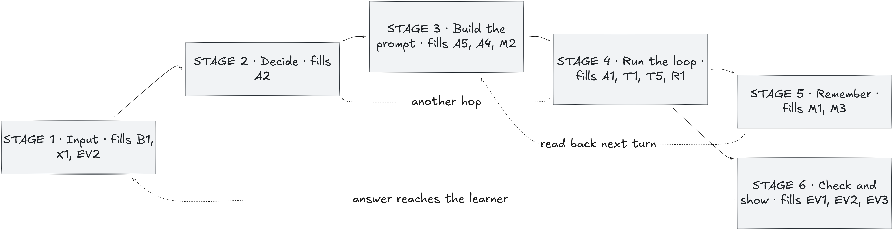
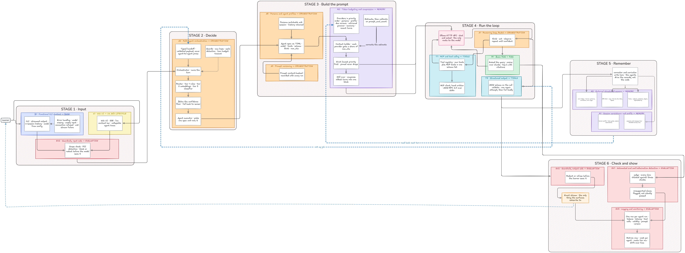

# Sensai — Local Japanese Tutor

A multi-agent AI assistant for learning Japanese, running 100% locally through Ollama.
No data ever leaves the machine.

📄 Full work plan: [`doc/work_plan.pdf`](doc/work_plan.pdf)
🗺️ Architecture: [overview](doc/architecture_overview.png) · [detailed](doc/architecture_detailed.png)
🗂️ Previous README: [`doc/README_old.md`](doc/README_old.md)

## Architecture

Every learner turn goes through six stages:

| Stage | Role | Features |
|-------|------|----------|
| 1 · Input | CLI / Web UI, input guardrails (scope, PII) | B1, X1, EV2 |
| 2 · Decide | Orchestrator, 3-tier router (rules → embeddings → classifier), typed handoffs | A2 |
| 3 · Build the prompt | Persona, versioned prompts, token budgeting and compression | A5, A4, M2 |
| 4 · Run the loop | ReAct loop, tools + MCP, RAG, structured output | A1, T1, T5, R1 |
| 5 · Remember | Sessions, profile, structured memory (errors, SRS, facts) | M1, M3 |
| 6 · Check and show | Hallucination judge, output guardrails, logging and metrics | EV1, EV2, EV3 |

Stage 4 can loop back to stage 2 ("another hop"), and stage 5 is read back on the next turn.

**Overview**



**Detailed** — same flow, with every component inside each stage



## Requirements

- Python 3.10+
- [Ollama](https://ollama.com) installed and running (`ollama serve`)
- Node.js 18+ (only for the web UI, layer 7)

## Installation

```bash
git clone <repo-url>
cd G-AIA-500-PAR-5-1-sensai-4

python -m venv venv
source venv/bin/activate
pip install -r requirements-dev.txt

ollama pull qwen3.5:4b      # default model until the bake-off (layer 2)
ollama pull bge-m3          # RAG embeddings (layer 5)
```

## Usage

```bash
python -m sensai                          # start the chat
python -m sensai --model qwen3.5:9b       # use another model
python -m sensai --config my-config.toml  # use another config file
```

In the chat: `/reset` clears the history, `/quit` exits.

## Configuration

Settings come from the built-in defaults (`sensai/core/config.py`), overridden by `config.toml`.
`--model` overrides the model for one run.

`model` and `num_ctx` are always explicit: we never inherit Ollama's defaults.
From layer 1, each agent gets its own `agents/<name>.toml` spec.

## Persistence

`sensai/memory/` stores sessions and history in SQLite, at the path from `[storage].db_path`
in `config.toml` (`:memory:` for tests).

- **Connection** (`db.py`): one `connect(path)` with `PRAGMA foreign_keys = ON`,
  `journal_mode = WAL`, and `row_factory = sqlite3.Row`.
- **Schema** (`migrations/001_init.sql`): `sessions` → `messages` (FK, cascade) → `turns`
  (links a user and an assistant message, with `latency_ms`/`tokens`) → `agent_runs` (one row
  per sub-step of a turn — `rag`, `guardrail`, a tool call — with `status` and `duration_ms`).
  Indexed on `messages.session_id`, `turns.session_id` and `agent_runs.turn_id`. `messages.parent_id`
  and `agent_runs.parent_run_id` are self-referencing (nullable, cascade) — unused for now, but in
  place so a later layer can branch a message (edits/retries) or nest an agent run without a
  migration.
- **Migrations** (`migrate.py`): applies every `NNN_*.sql` file above the DB's
  `PRAGMA user_version`, in order; re-running is a no-op once every file is applied.
- **Access pattern** (`repository.py`): a synchronous `SessionRepository`
  (`create_session`, `add_message`, `list_messages`, `record_turn`, `record_agent_run`) plus an
  `AsyncSessionRepository` facade that runs each call through `asyncio.to_thread`. We chose that
  over `aiosqlite` because it needs no new dependency, keeps the storage logic in one place that
  stays trivial to unit-test synchronously, and the thread-pool overhead is irrelevant at
  Sensai's scale (one learner, a handful of DB calls per turn) — the web UI (layer 7) can await
  the facade without blocking its event loop.

Wiring `orchestration/chat.py` to load and save history through the repository lands with
`run_turn()` in layer 2, per the rule above: `chat.py` is already marked as replaced there, so
the base loop keeps its current in-session-only history until that layer starts.

## Features

Committed: six of the seven ★★★ features (T2 is declined on purpose — a Japanese tutor has no honest use for running generated code).

| Code | Feature | Rating | Layer | Status |
|------|---------|--------|-------|--------|
| B1 | CLI chatbot (streaming, history, errors) | 👍 | 1–2 | 🚧 |
| M1 | Session persistence & profile | ★ | 2 | ⏳ |
| T5 | Structured output (JSON schema, one repair) | ★ | 3 | ⏳ |
| M3 | Structured memory (errors, SRS, facts) | ★★ | 3, 6 | ⏳ |
| T1 | Tools (dictionary, conjugate, kanji) + MCP | ★★★ | 3, 5 | ⏳ |
| EV3 | Logging, metrics, per-turn trace | ★★ | 3–4 | ⏳ |
| A2 | Multi-agent orchestration + router | ★★★ | 4–5 | ⏳ |
| A1 | ReAct (corrector) | ★★★ | 4 | ⏳ |
| M2 | Token budgeting & compression | ★★ | 4–5 | ⏳ |
| R1 | Basic RAG (citations, JLPT metadata) | ★★ | 5 | ⏳ |
| EV1 | Judge: claim-by-claim verification | ★★★ | 5 | ⏳ |
| R2 | Advanced RAG (reranking, scoring) | ★★★ | 6 | ⏳ |
| EV2 | Input / output guardrails | ★★★ | 6 | ⏳ |
| A5 | Switchable personas mid-session | ★ | 6 | ⏳ |
| A4 | Prompt versioning (content hash) | ★ | 6 | ⏳ |
| X1 | Web UI (FastAPI + SSE) | ★ | 7 | ⏳ |
| EV4 | Adversarial suite | ★★ | 7 | ⏳ |
| A6 | Semantic cache (optional) | ★★ | 7 | ⏳ |

✅ done · 🚧 in progress · ⏳ to do — **Never cut:** T1, R2, A1, A2, EV1, EV2.

## Layered plan

| Layer | Content |
|-------|---------|
| 1 | Foundations: contracts (events, AgentSpec, Handoff, config), SQLite, Ollama transport, CLI + logger |
| 2 | Base loop: `run_turn()`, persistence, model bake-off, error handling |
| 3 | Real memory: structured output, ledger, own tools, metrics v1 |
| 4 | Multi-agent: orchestrator, per-agent context, ReAct corrector, trace view |
| 5 | Knowledge & routing: router, compression, RAG + external MCP, judge |
| 6 | Three-star finish: personas & prompts, curriculum agent, advanced RAG, guardrails |
| 7 | Surface & proof: web UI, semantic cache, adversarial suite |
| 8 | Delivery: demo script, crew vs monolith measurement, fallback videos, README |

Rule: never start a layer until the previous layer's contracts are **merged**.

## Code architecture

### Packages

One package per domain, each owned by one member so parallel branches rarely touch the same files.
Each package's `__init__.py` lists the modules that belong in it and the layer that adds them,
so new code always has an obvious home.

```
sensai/
  core/           shared contracts: messages, errors, config, events, specs    (A)
  llm/            Ollama HTTP transport, the only code that calls the model    (C)
  orchestration/  turn loop, executor, orchestrator, router                     (A)
  memory/         SQLite storage, sessions, ledger, context budgeting           (B)
  knowledge/      tools, MCP client, RAG pipeline                               (C)
  trust/          guardrails, judge, logging, metrics                           (D)
  surfaces/       CLI and web UI                                                (D)
agents/           one TOML spec per agent (sensei, corrector, judge, ...)      (from layer 1)
tests/            one folder per package, mirroring sensai/
doc/              work plan, architecture diagrams, previous README
config.toml       project configuration
```

Runtime files (`data/*.db`, `logs/`) are created on first run and never committed.

### Rules that keep it stable

- **Dependencies point inward.** Every package may import `core`; `core` imports nothing from the
  others. `surfaces` never contains business logic.
- **Agents are data, not code.** From layer 1, an agent is a TOML file loaded into an `AgentSpec`
  (model, `num_ctx`, prompt, tools, output schema). Adding the corrector or the judge means adding a file.
- **One transport for every agent.** `OllamaClient.chat_stream(model, messages, num_ctx=...)` takes the
  model and options on each call, so agents with different models share one client. Errors carry a `kind`
  (`model_missing`, `connection`, `timeout`, `bad_request`, `stream`) that surfaces can display.
- **Surfaces only subscribe.** From layer 1, the turn loop emits events (`core/events.py`) and the
  CLI, the logger, the trace view and the web UI only consume them.

### How a turn flows

| Stage | Package |
|-------|---------|
| 1 · Input | `surfaces` → `trust` (input guardrails) |
| 2 · Decide | `orchestration` (orchestrator, router) |
| 3 · Build the prompt | `memory` (context builder, budget) with the agent's spec from `core` |
| 4 · Run the loop | `orchestration` (executor) → `llm`, `knowledge` (tools, RAG) |
| 5 · Remember | `memory` (sessions, ledger) |
| 6 · Check and show | `trust` (judge, output guardrails, logging) → events → `surfaces` |

Today the base loop is `orchestration/chat.py`: one agent, streaming, in-session history.

## Organisation

### Branches

Every sub-issue has its own branch, named `layerN/<owner letter>-<task>` (e.g. `layer1/c-ollama-transport`).
Each layer also has an integration branch, `layer1/integration` through `layer8/integration`, where the four
tasks of the layer are merged and checked together before reaching `main`.

> Git does not allow a branch called `layer1` while branches like `layer1/a-…` exist, so each integration
> branch sits in its layer's folder next to the task branches.

### Workflow

```
layer1/a-core-contracts-…   ─┐
layer1/b-sqlite-schema-…    ─┤  PR  →  layer1/integration  ──  PR  →  main  →  Epitech repo
layer1/c-ollama-transport   ─┤         (merge all 4 and check)
layer1/d-cli-renderer-…     ─┘
```

1. Each person opens a PR from their task branch into `layerN/integration`.
2. When all four are merged, test the layer together on that branch and check its "Done when" condition.
3. Open one PR from `layerN/integration` into `main`. Once it merges, the CI pushes to the Epitech repo.

The CI runs the tests and the 85% coverage check on every push and every PR to any branch.
The push to Epitech only happens from `main`, so nothing on an integration branch reaches the Epitech repo early.

### Before starting a layer

The integration branches for layers 2–8 were created from an early `main`. Before starting a layer,
update its integration branch and the task branches from `main` so they include the previous layer's work:

```bash
git switch layer2/integration && git merge main && git push
```

## CI

Code is pushed to the mirror repo. Every push runs the tests with coverage
(**blocking under 85%**, reports kept as artifacts for 90 days); if everything passes on `main`,
the full history is pushed to the Epitech repo.

```bash
python -m pytest --cov          # locally
```

## User stories

Two user stories per feature, written when the feature is specced: see [`user_stories.md`](user_stories.md).

## Team

| Member | Role | Owns |
|--------|------|------|
| A | Core | Ollama transport, event stream, agent executor, orchestrator, router, config |
| B | Memory | SQLite, profile, facts, SRS, context builder, budgeting, compression |
| C | Knowledge | Tool registry, own tools, MCP client, RAG pipeline, corrector spec |
| D | Trust & surface | Logging, metrics, trace view, judge spec, guardrails, CLI and Web UI |
