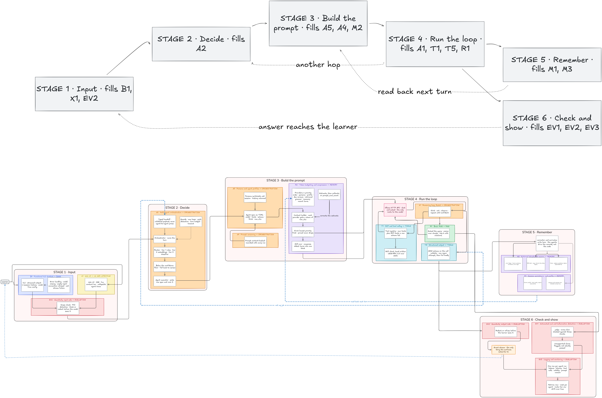

# Sensai — Local Japanese Tutor

A multi-agent AI assistant for learning Japanese, running 100% locally through Ollama.
No data ever leaves the machine.

📄 Full work plan: [`doc/work_plan.pdf`](doc/work_plan.pdf)
🗺️ Detailed architecture: [`doc/architecture.png`](doc/architecture.png)
🗂️ Previous README: [`doc/README_old.md`](doc/README_old.md)

## Architecture

Every learner turn goes through six stages:

| Stage | Role | Features |
|-------|------|----------|
| 1 · Input | CLI / Web UI, input guardrails (scope, PII) | B1, X1, EV2 |
| 2 · Decide | Orchestrator, 3-tier router (rules → embeddings → classifier), typed handoffs | A2 |
| 3 · Build the prompt | Persona, versioned prompts, token budgeting and compression | A5, A4, M2 |
| 4 · Run the loop | ReAct loop, tools + MCP, RAG, structured output | A1, T1, T5, R1 |
| 5 · Remember | Sessions, profile, structured memory (errors, SRS, facts) | M1, M3 |
| 6 · Check and show | Hallucination judge, output guardrails, logging and metrics | EV1, EV2, EV3 |

Stage 4 can loop back to stage 2 ("another hop"), and stage 5 is read back on the next turn.



## Requirements

- Python 3.10+
- [Ollama](https://ollama.com) installed and running (`ollama serve`)
- Node.js 18+ (for the web UI)

## Installation

```bash
git clone <repo-url>
cd G-AIA-500-PAR-5-1-sensai-4

python -m venv venv
source venv/bin/activate
pip install -r requirements-dev.txt

ollama pull qwen3.5:9b      # final model decided by the bake-off (layer 2)
ollama pull bge-m3          # RAG embeddings
```

## Usage

**CLI**
```bash
python -m sensai.main
python -m sensai.main --model qwen3.5:4b    # another model
```

**Web UI**
```bash
uvicorn api.main:app --reload               # backend: http://127.0.0.1:8000
cd frontend && npm install && npm run dev   # frontend: http://localhost:5173
```

## Configuration

Everything is set in `config.yaml` (model, RAG, persona, guardrails…) without touching the code.
`model` and `num_ctx` are always explicit: we never inherit Ollama's defaults.

## Features

Committed: six of the seven ★★★ features (T2 is declined on purpose — a Japanese tutor has no honest use for running generated code).

| Code | Feature | Rating | Layer | Status |
|------|---------|--------|-------|--------|
| B1 | CLI chatbot (streaming, history, errors) | 👍 | 1–2 | 🚧 |
| M1 | Session persistence & profile | ★ | 2 | ⏳ |
| T5 | Structured output (JSON schema, one repair) | ★ | 3 | ⏳ |
| M3 | Structured memory (errors, SRS, facts) | ★★ | 3, 6 | ⏳ |
| T1 | Tools (dictionary, conjugate, kanji) + MCP | ★★★ | 3, 5 | ⏳ |
| EV3 | Logging, metrics, per-turn trace | ★★ | 3–4 | ⏳ |
| A2 | Multi-agent orchestration + router | ★★★ | 4–5 | ⏳ |
| A1 | ReAct (corrector) | ★★★ | 4 | ⏳ |
| M2 | Token budgeting & compression | ★★ | 4–5 | ⏳ |
| R1 | Basic RAG (citations, JLPT metadata) | ★★ | 5 | ⏳ |
| EV1 | Judge: claim-by-claim verification | ★★★ | 5 | ⏳ |
| R2 | Advanced RAG (reranking, scoring) | ★★★ | 6 | ⏳ |
| EV2 | Input / output guardrails | ★★★ | 6 | ⏳ |
| A5 | Switchable personas mid-session | ★ | 6 | ⏳ |
| A4 | Prompt versioning (content hash) | ★ | 6 | ⏳ |
| X1 | Web UI (FastAPI + SSE) | ★ | 7 | ⏳ |
| EV4 | Adversarial suite | ★★ | 7 | ⏳ |
| A6 | Semantic cache (optional) | ★★ | 7 | ⏳ |

✅ done · 🚧 in progress · ⏳ to do — **Never cut:** T1, R2, A1, A2, EV1, EV2.

## Layered plan

| Layer | Content |
|-------|---------|
| 1 | Foundations: contracts (events, AgentSpec, Handoff, config), SQLite, Ollama transport, CLI + logger |
| 2 | Base loop: `run_turn()`, persistence, model bake-off, error handling |
| 3 | Real memory: structured output, ledger, own tools, metrics v1 |
| 4 | Multi-agent: orchestrator, per-agent context, ReAct corrector, trace view |
| 5 | Knowledge & routing: router, compression, RAG + external MCP, judge |
| 6 | Three-star finish: personas & prompts, curriculum agent, advanced RAG, guardrails |
| 7 | Surface & proof: web UI, semantic cache, adversarial suite |
| 8 | Delivery: demo script, crew vs monolith measurement, fallback videos, README |

Rule: never start a layer until the previous layer's contracts are **merged**.

## Structure

```
sensai/      Python code (agents, memory, RAG, tools, guardrails)
api/         FastAPI backend
frontend/    React interface
tests/       pytest tests
doc/         work plan, architecture diagram, previous README
data/        demo data
personas/    persona configurations
```

## CI

Code is pushed to the mirror repo. Every push runs the tests with coverage
(**blocking under 85%**, reports kept as artifacts for 90 days); if everything passes on `main`,
the full history is pushed to the Epitech repo.

```bash
python -m pytest --cov          # locally
```

## User stories

Two user stories per feature, written when the feature is specced: see [`user_stories.md`](user_stories.md).

## Team

| Member | Role | Owns |
|--------|------|------|
| A | Core | Ollama transport, event stream, agent executor, orchestrator, router, config |
| B | Memory | SQLite, profile, facts, SRS, context builder, budgeting, compression |
| C | Knowledge | Tool registry, own tools, MCP client, RAG pipeline, corrector spec |
| D | Trust & surface | Logging, metrics, trace view, judge spec, guardrails, CLI and Web UI |
